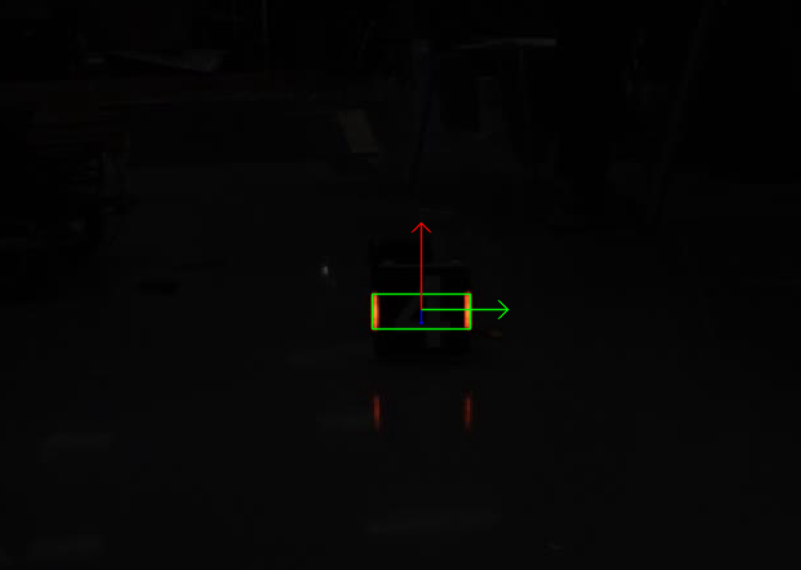
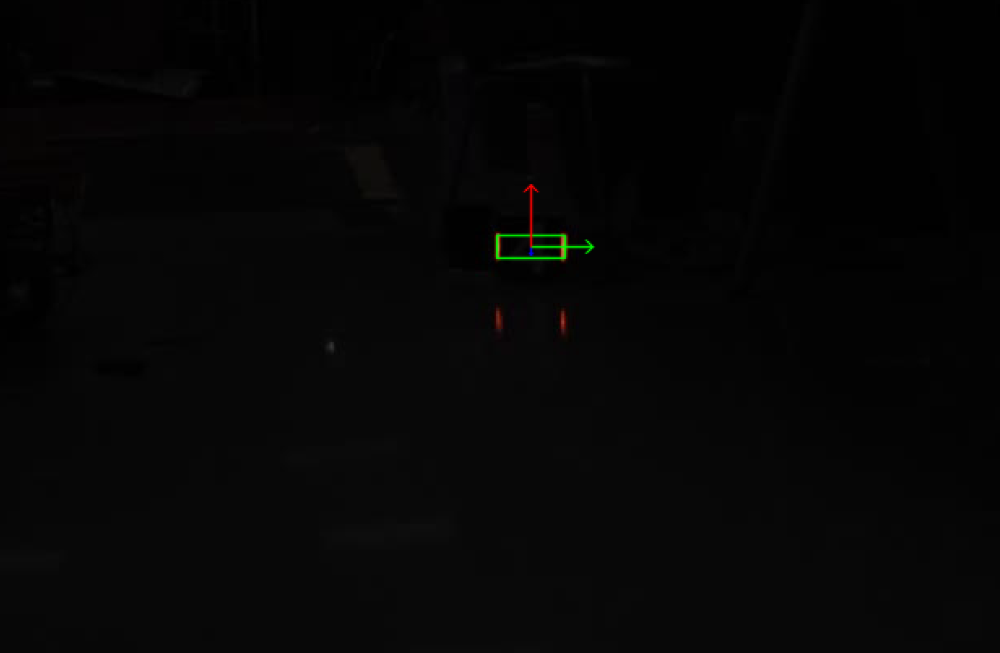

1 、思路：

使用VideoCapture创建cap对象并传入Mat，获取当前帧图像

使用cvtColor函数把BGR图像转换为HSV图像

结合inRange函数和Scalar实现图像二值化，获得掩膜

使用findContours函数查找掩膜中的轮廓并存进二维数组

遍历每一个轮廓，把不符合要求的跳过，其余合并装进一个一维数组

使用minAreaRect获取包围灯条的最小旋转矩形，创建数组存入矩形的四个顶点，并按左上、右上、右下、左下的顺序排列

遍历顶点，使用line函数把相邻顶点连线

位姿解算：

创建世界坐标系，将灯条左上、右上、右下、左下的坐标存入数组，使用SolvePnP实现位姿解算，获得rvec,tvec

根据rvec,tvec的数据，代入世界坐标系下的四个坐标轴位置，使用projectPoints函数计算出其在图像中的位置，最后使用arrowedLine函数把坐标轴连起来

2、进度：

目前已完成包括选做部分的所有内容

3、过程中遇到的问题：

在初次调用line时出现连线有锯齿，后加入LINE_AA抗锯齿参数得以解决

在调用projectPoints完成投影坐标计算时，偶尔出现坐标轴翻转问题，后使用使用上一帧rvec,tvec值进行当前帧迭代处理，问题得以解决

运行时图片：

